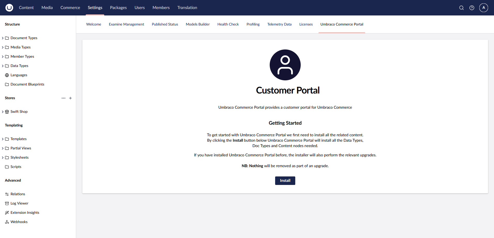
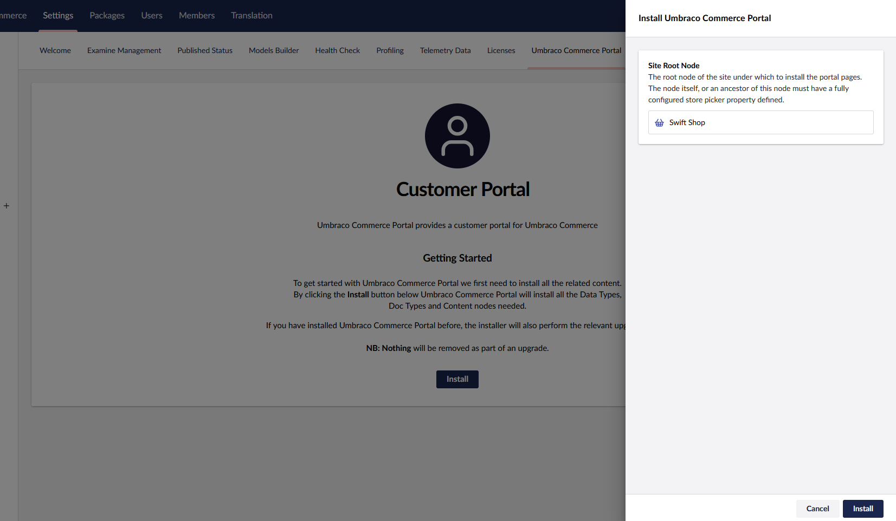
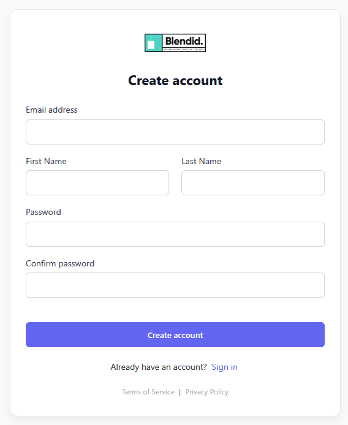
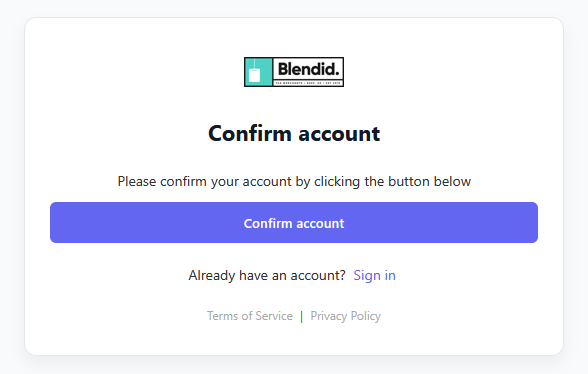
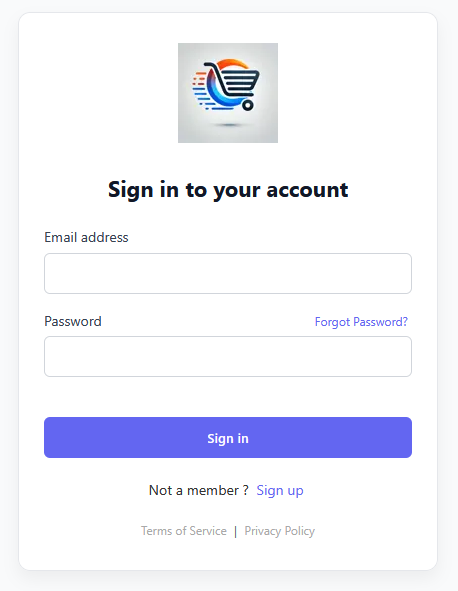
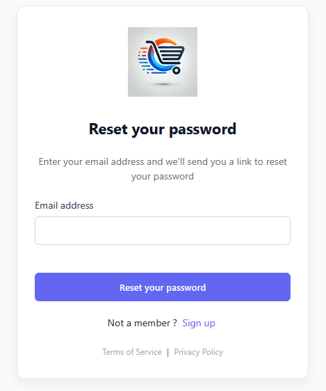
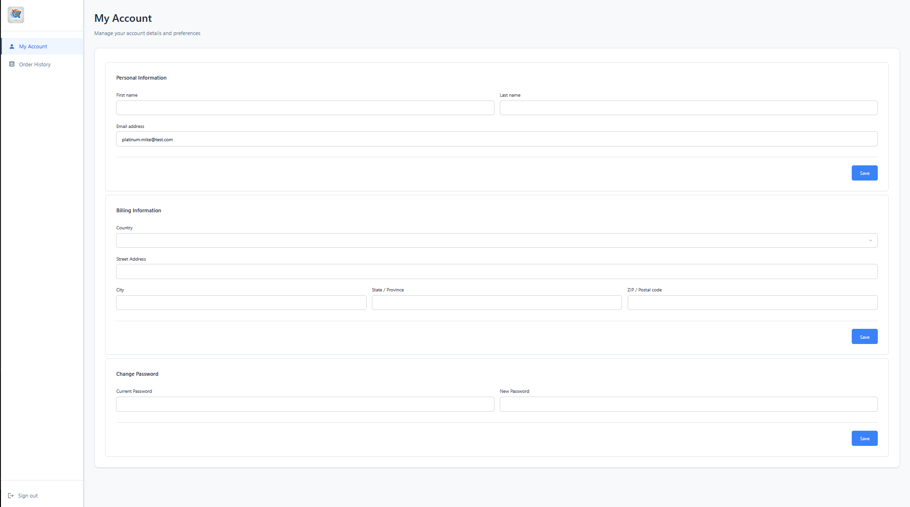
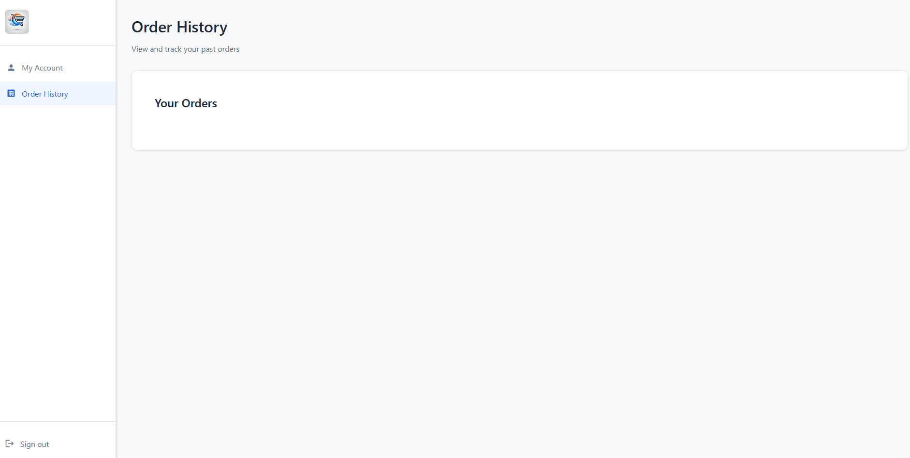

# Umbraco.Commerce.Portal

A ready made customer portal for Umbraco Commerce, allowing users to log in, manage their profiles and view order history.

## About

Umbraco Commerce Portal is an add-on package for Umbraco Commerce, providing customer with a fully customized and integrated solution for managing account details and order history.

## Installation

To install the customer portal, access the `Umbraco Commerce Portal` dashboard from the `Settings` section of the backoffice, and select the root node for the portal nodes to be installed under.

## Features

### Portal Authorization

The authorization area allows customers to perform one the following actions:

* Register

Upon registration, a confirmation email will be sent to the customer with a requirement for account confirmation:

* Login

* Reset Password

### Portal Management

The portal management area is a secure location only accessible to members of type `Customer`.

Within their private space, they are able to manage their account details and view order history.

The My Account section lets members edit their personal information (name, email and phone number), manage an address book of billing and shipping addresses, and change their password.

Profile details and addresses are stored on the member's Umbraco Commerce customer for the current store, not on the member. Portal creates or links that customer the first time the member signs in or registers. Addresses from finalized orders appear in the address book automatically.

Older versions stored the profile in properties of the `ucpMember` member type (`ucpMemberFirstName`, `ucpMemberLastName`, `ucpMemberCountry`, `ucpMemberStreet`, `ucpMemberCity`, `ucpMemberState`, `ucpZipCode`). Portal copies these onto the customer once, on the member's first visit, and no longer writes them. The properties and the member type are left in place.

Under `Order History` the customer can review their past orders and their details. These views are only with read-only purposes.

## Working locally

To fork and build your own Commerce Portal package, you will need:
* .NET 11 SDK (see `global.json`)
* Umbraco 19.0.0 or newer
* Umbraco Commerce 19.0.0 or newer
* NodeJS 24.13+ for frontend development. Open `/src/Umbraco.Commerce.Portal/Client` folder and run `npm install; npm run build`

## Raising an Issue

If you find any issues with the Umbraco Commerce Checkout add-on itself please raise them in the [issues section of this repository](https://github.com/umbraco/Umbraco.Commerce.Portal/issues)

## License

Copyright © 2025 Umbraco

This demo store is [licensed under MIT](LICENSE.md). The core Umbraco Commerce product is licensed under Umbracos commercial license.
